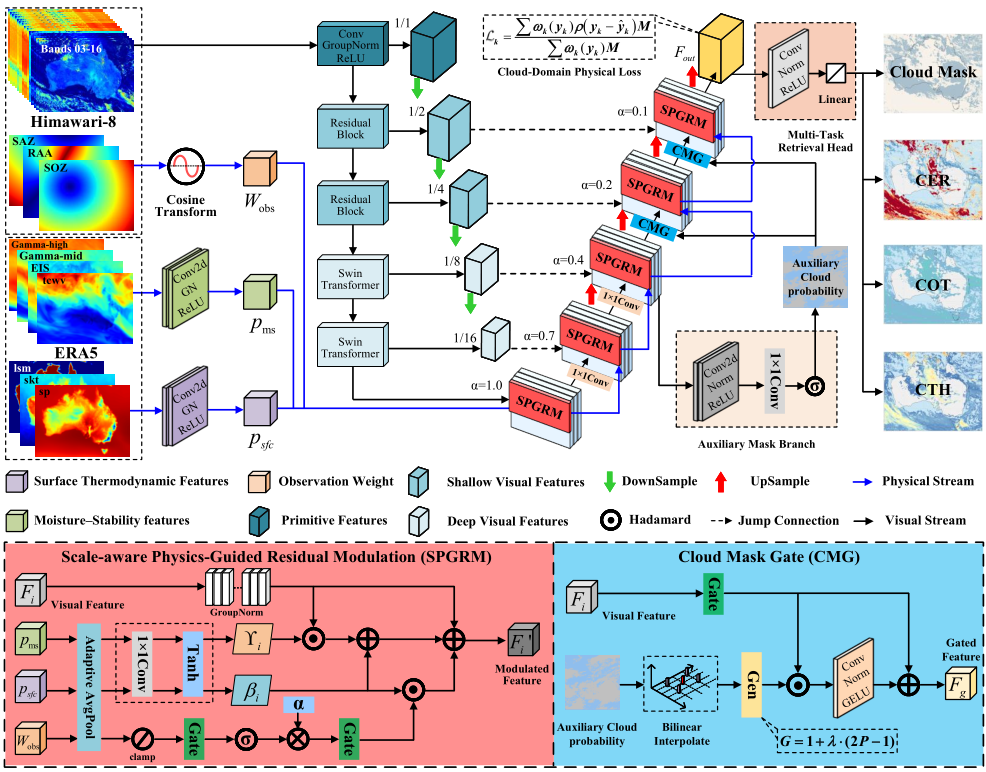

# Scale-aware physics-guided dual-constraint learning for joint cloud property retrieval from Himawari-8 and ERA5 

Xiao Wei, Bing Tu∗, Jun Li, Yan He, Chao Liu and Antonio Plaza, "Scale-aware physics-guided dual-constraint learning for joint cloud property retrieval from Himawari-8 and ERA5 ", Atmospheric Research, 2026

> 💡 **Abstract:**  *Precise retrieval of cloud properties from satellite observations is crucial for quantifying theEarth's radiation budget and understanding the hydrological cycle. However, existing cloudproperty retrieval methods still struggle to ensure physical plausibility in clear-sky regions and toreconcile the scale mismatch between large-scale atmospheric environments and high-resolutionsatellite radiances. To address these challenges, this study proposes a Scale-aware Physics-guided Dual-Constraint Network (SPDC-Net) for the joint retrieval of cloud mask, cloud topheight (CTH), cloud optical thickness (COT), and cloud effective radius (CER) from daytimeHimawari-8 observations and ERA5 reanalysis. Specifically, ERA5 atmospheric and surfacevariables are decomposed into complementary physical representations and progressively in-jected into multi-scale visual features via scale-aware residual modulation, while a cloud-mask-guided structural constraint explicitly confines continuous-parameter retrievals to physicallyvalid cloudy regions. In addition, we construct an Australian Cloud Retrieval Dataset (AUS-CRD) covering Australia and its surrounding oceans through unified spatiotemporal collocationand quality-controlled preprocessing. Experimental results demonstrate that SPDC-Net provideseffective joint cloud-property retrieval with spatial structure preservation, accepting a modestcompromise in overall cloud-mask metrics for enhanced detection sensitivity. Analyses of ex-treme convective events, seasonal patterns, and land-ocean contrasts, together with independentvalidation against CALIPSO, further show that SPDC-Net captures the main spatial patternsand statistical characteristics of cloud fields. This work offers new insights into physics-guidedlearning for satellite remote sensing and highlights the effectiveness of integrating cross-scalephysical priors with explicit structural constraints for high-fidelity cloud-property retrieval. Thecode is available at https://github.com/2001weixiao/SPDC-Net.*

  

**Fig. 1. Overall architecture of the proposed SPDC-Net for joint cloud-property retrieval. The SPGRM progressively injects ERA5-derived physical priors into multi-scale visual features to bridge the cross-scale gap, while the CMG module couples the auxiliary cloud probability with regression features to confine continuous retrievals to physically valid cloudy regions and provide a mechanism to limit potential spurious clear-sky responses.** 

## Dependencies

Python 3.9

PyTorch 2.5.0 (with CUDA 12.1)

## Sensitivity Analysis

To investigate the impact of principal hyperparameters on SPDC-Net, we conducted a comprehensive sensitivity analysis. Each experiment changes only one factor while all other settings are fixed to the reference configuration. 

**Evaluation Protocol:** The hyperparameters and the cloud-mask threshold were selected using *only the validation set*. For each run, the best checkpoint and the CSI-optimal cloud-mask threshold were chosen from the validation predictions. The test set was strictly reserved for the final evaluation reported here, and the saved threshold is applied without any further adjustment.

| Factor | Value | COT   (R/RMSE/MAE/MBE) | CER   (R/RMSE/MAE/MBE) | CTH   (R/RMSE/MAE/MBE) | Cloud mask   (OA/POD/FAR/CSI) |
| :--- | :--- | :---: | :---: | :---: | :---: |
| **Reference model** | $\lambda_{\max}=0.8$ $\gamma=0.5$ $\boldsymbol{\eta}=(0.4,0.6,0.3)$ $\boldsymbol{\alpha}=(1.0,0.7,0.4,0.2,0.1)$ | **0.8241/3.58/1.97/-0.37** | **0.8807/5.33/3.37/-0.12** | **0.9442/1.62/0.84/0.05** | **0.8870/0.9402/0.1613/0.7962** |
| $\lambda_{\max}$ | 0.4 | 0.8070/3.73/2.09/-0.45 | 0.8664/5.61/3.58/-0.18 | 0.9366/1.73/0.93/0.08 | 0.8878/0.9416/0.1609/0.7976 |
| | 0.6 | 0.8070/3.73/2.09/-0.44 | 0.8665/5.61/3.59/-0.18 | 0.9366/1.72/0.93/0.08 | 0.8878/0.9414/0.1608/0.7975 |
| $\gamma$ | 1.0 | 0.8086/3.71/2.08/-0.38 | 0.8679/5.60/3.58/-0.07 | 0.9369/1.72/0.92/0.13 | 0.8888/0.9402/0.1585/0.7988 |
| | 2.0 | 0.8086/3.72/2.08/-0.40 | 0.8681/5.61/3.59/-0.01 | 0.9373/1.72/0.92/0.09 | 0.8898/0.9391/0.1561/0.8001 |
| Tail-aware loss $\boldsymbol{\eta}$ | $(0,0,0)$ | 0.8072/3.76/2.07/-0.59 | 0.8689/5.54/3.53/-0.43 | 0.9379/1.70/0.91/0.03 | 0.8887/0.9403/0.1587/0.7986 |
| | $(0.2,0.3,0.15)$ | 0.8082/3.73/2.07/-0.49 | 0.8684/5.56/3.54/-0.25 | 0.9374/1.71/0.92/0.07 | 0.8887/0.9405/0.1588/0.7987 |
| | $(0.6,0.9,0.45)$ | 0.8088/3.71/2.08/-0.37 | 0.8673/5.61/3.58/-0.10 | 0.9372/1.72/0.91/0.10 | 0.8884/0.9409/0.1595/0.7984 |
| | $(0.8,1.2,0.6)$ | 0.8087/3.71/2.09/-0.33 | 0.8665/5.65/3.61/-0.04 | 0.9367/1.73/0.92/0.11 | 0.8881/0.9408/0.1599/0.7979 |
| Stage-wise $\boldsymbol{\alpha}$ | Uniform: $(1,1,1,1,1)$ | 0.8084/3.72/2.08/-0.44 | 0.8680/5.58/3.56/-0.15 | 0.9375/1.71/0.91/0.09 | 0.8886/0.9406/0.1590/0.7986 |
| | Weak: $(0.5,0.35,0.2,0.1,0.05)$ | 0.8082/3.72/2.08/-0.43 | 0.8677/5.59/3.57/-0.16 | 0.9368/1.72/0.92/0.09 | 0.8884/0.9397/0.1588/0.7982 |
| | Reverse: $(0.1,0.2,0.4,0.7,1.0)$ | 0.8083/3.72/2.08/-0.43 | 0.8679/5.58/3.57/-0.16 | 0.9375/1.71/0.91/0.09 | 0.8885/0.9399/0.1587/0.7984 |

## Datasets

We construct the **Australian Cloud Retrieval Dataset (AUS-CRD)**, a multi-source dataset covering Australia and its surrounding oceans, built by jointly collocating Himawari-8 (AHI) observations, ERA5 reanalysis, and MODIS (Aqua) cloud products through unified spatiotemporal alignment and physics-consistent preprocessing. The dataset provides paired satellite radiances, atmospheric reanalysis fields, and cloud property labels (cloud mask, CTH, COT, CER) for model training and evaluation.

Detailed dataset construction procedures, preprocessing code, and the full data description will be released upon acceptance of the paper.

## Usage
For any questions, feel free to contact us  [weixiao0124@126.com](mailto:weixiao0124@126.com).

## Citation
If you find the code helpful in your research or work, please cite the following paper.
